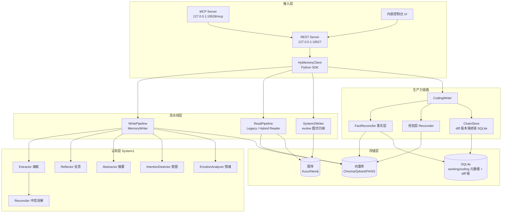
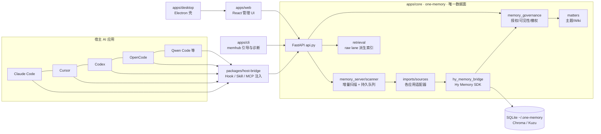
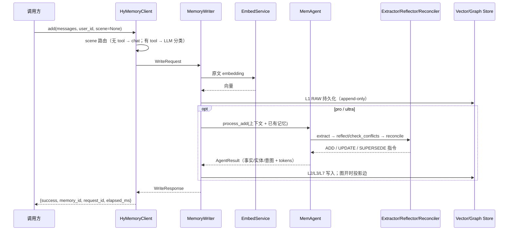

# Hy Memory Code Wiki

> 本文档是对 **Hy Memory** 仓库的结构化代码百科，覆盖整体架构、模块职责、关键类与函数、依赖关系，以及 SDK 与 MemHub 两套产品的运行方式。
>
- SDK 版本：`hy-memory==2.0.4`（PyPI）
- MemHub 版本：`1.0.4`（build 13），CLI npm 包：`memhub-cli`
- 许可证：Apache-2.0
- 仓库：`Tencent-Hunyuan/Hy-Memory`

---

## 目录

1. [项目概述](#1-项目概述)
2. [仓库结构总览](#2-仓库结构总览)
3. [整体架构](#3-整体架构)
4. [Hy Memory SDK（`hy_memory/`）](#4-hy-memory-sdkhy_memory)
5. [MemHub 子项目（`memhub/`）](#5-memhub-子项目memhub)
6. [依赖关系总览](#6-依赖关系总览)
7. [配置与环境变量](#7-配置与环境变量)
8. [项目运行方式](#8-项目运行方式)
9. [测试体系](#9-测试体系)
10. [CI 与发布](#10-ci-与发布)
11. [文档与延伸阅读](#11-文档与延伸阅读)

---

## 1. 项目概述

**Hy Memory** 是腾讯混元开源的、面向自演化 LLM Agent 的**工业级双系统认知记忆框架**。仓库在一个 monorepo 中同时发布两类产物：

| 产物 | 位置 | 形态 | 使用者 |
|---|---|---|---|
| **Hy Memory SDK** | 仓库根 `hy_memory/` | Python 包 `hy-memory`（PyPI） | Agent / 插件开发者，以库或本地 HTTP/MCP 服务形式嵌入 |
| **MemHub** | `memhub/` | 本地优先的桌面应用 + CLI + Runtime | 终端用户：把 Claude Code、Cursor、Codex、OpenCode、Qwen Code 等多个 AI 应用的历史统一汇入本地记忆并跨工具召回 |

SDK 按任务类型提供三种记忆场景（`scene`）：

| `scene` | 面向任务 | 记忆形态 |
|---|---|---|
| `chat` | 闲聊、偏好、个人信息 | **L0–L7 多层认知记忆**（事实/摘要/图式/意图） |
| `working` | 文档、研究、财经、内容创作等生产力任务 | **双层记忆**：会话事实 `WorkingFact` + 可复用经验 `Experience` |
| `coding` | 编码、调试、测试等软件工程任务 | 与 working 同构的双层记忆 + **代码版本演进链（diff 链）** |

三档处理模式（`mode`）：

| 模式 | LLM | 图数据库 | 说明 |
|---|---|---|---|
| `lite` | 不调用 | 否 | 纯向量 RAG，忽略 `scene`/`layers`，零 LLM 开销 |
| `pro`（默认） | 提取 + 冲突消解 | 可选（`MEMORY_ENABLE_GRAPH`，默认关） | 标准模式 |
| `ultra` | pro + System 2 图式归纳 | 强制开启 | 通过 `evolve()` 触发完整认知加工 |

---

## 2. 仓库结构总览

```text
hy-memory/
├── hy_memory/                 # Hy Memory Python SDK（包名 hy-memory）
│   ├── client.py              #   用户级主客户端 HyMemoryClient（~3000 行，核心门面）
│   ├── config.py              #   MemoryConfig：.env / 环境变量配置
│   ├── runtime.py             #   SharedRuntime：多 client 共享事件循环与资源
│   ├── server.py              #   零依赖本地 REST Server（ThreadingHTTPServer，:19527）
│   ├── server_ui.py           #   内嵌静态资源的本地控制台 Web UI
│   ├── mcp_server.py          #   MCP Server（FastMCP，HTTP :19528/mcp 或 stdio）
│   ├── inspector.py           #   MemoryInspector：调用链日志/变动审计
│   ├── structure.py           #   L2 记忆的规范化结构元数据（topic/facet/series/episode）
│   ├── metrics.py             #   SDK 指标
│   ├── models/                #   Pydantic 数据模型（记忆节点、请求/响应）
│   ├── agent/                 #   System 1 认知智能体（抽取/反思/消解/摘要/意图/情绪）
│   ├── pipelines/             #   写入/读取流水线、System2、检索与图子包
│   ├── coding/                #   Working/Coding 双层记忆与 diff 版本演进链
│   ├── core/                  #   嵌入服务、合并、评分、并发预算
│   └── utils/                 #   日志、追踪、分词、token 计数等横切工具
├── tests/                     # SDK 单测（pytest + pytest-asyncio）
├── plugins/                   # 宿主集成插件（openclaw 为 TS 插件；hook/mcp 预留）
├── docs/                      # 设计/使用文档、架构图、论文 PDF
├── memhub/                    # MemHub 产品子项目（独立可构建的 pnpm monorepo）
│   ├── apps/core/             #   Python FastAPI Kernel / Runtime 数据面（包 one-memory）
│   ├── apps/cli/              #   TypeScript CLI（bin: memhub / memhub-cli / one-memory）
│   ├── apps/desktop/          #   Electron 桌面壳（macOS 签名/公证）
│   ├── apps/web/              #   React 19 + Vite 管理界面
│   ├── packages/              #   contracts / host-bridge / operations / runtime-control
│   └── scripts/               #   构建、打包、发布、校验脚本
├── import_codex.py            # 一次性 Codex 历史导入脚本（走本地 REST）
├── keepalive.bat / .pyw / .vbs  # Windows 下常驻保活脚本
├── _ui_check.js               # 本地控制台 UI 检查脚本
├── pyproject.toml             # SDK 构建/依赖/pytest/ruff 定义
├── MANIFEST.in / .env.example
└── .github/workflows/         # ci.yml / linux-lifecycle.yml / release.yml
```

**边界约定**（见 [docs/monorepo.md](monorepo.md)）：SDK 命令在仓库根执行；MemHub 命令在 `memhub/` 内执行；MemHub 通过固定版本 `hy-memory==2.0.4` 的公开 PyPI 包消费 SDK，而不是相对路径引用。

---

## 3. 整体架构

### 3.1 SDK 概念架构



### 3.2 Chat 记忆分层（L0–L7）

| 层 | 枚举 | 名称 | 内容 |
|---|---|---|---|
| L0 | `BASIC_INFO` | 基础信息 | 用户基础画像 |
| L1 | `RAW` | 原始对话 | append-only 原文 |
| L2 | `FACT` | 原子事实 | 版本化、不可变记录 |
| L3 | `SUMMARY` | 会话摘要 | episode 粒度总结 |
| L4 | `IDENTITY` | 身份层（保留） | — |
| L5 | `KNOWLEDGE` | 知识层（保留） | — |
| L6 | `SCHEMA` | 心智图式 | 抽象叙事模板，图层 |
| L7 | `INTENTION` | 前瞻意图 | 带有效期，过期转普通事实 |

### 3.3 MemHub 产品架构



核心原则（[memhub/README.md](../memhub/README.md)）：一次安装、一个 Runtime、一份数据、多种客户端；**Python Core 是唯一记忆数据面和唯一业务数据库写入者**；来源读取、模型处理、宿主读取是三条相互独立的授权边界；正式记忆链路保持 `Evidence -> Hy Memory -> Governance -> Matters/Wiki`；不采集屏幕/辅助功能/OCR/键鼠/剪贴板/录音。

---

## 4. Hy Memory SDK（`hy_memory/`）

### 4.1 包入口 `__init__.py`

[hy_memory/\_\_init\_\_.py](../hy_memory/__init__.py) 导出四组公共符号：

- **用户级 API**：`HyMemoryClient`、`MemoryInspector`、`SharedRuntime`
- **配置**：`MemoryConfig`
- **Embedding 端点覆盖**：`embed_endpoint_override`（per-call / contextvar 两种用法）
- **高级管线 API**：`ComponentFactory`、`PipelineConfig`、`WritePipeline`、`ReadPipeline`、`ChatMessage`、`WriteRequest/Response`、`ReadRequest/Response`
- **数据模型**：`MemoryLayer`、`MemoryNode`、`MemoryEntry`、各 Request/Response 等

### 4.2 入口层

#### `client.py` — `HyMemoryClient`

[hy_memory/client.py](../hy_memory/client.py) 是整个 SDK 的门面。客户端**无状态、可多线程共享**：构造函数只接收连接配置与处理模式，业务隔离参数在每次调用时传入。

```python
HyMemoryClient(
    config: MemoryConfig | None = None,   # 默认 MemoryConfig.from_env()
    mode: "lite" | "pro" | "ultra" = None,  # 默认读 MEMORY_MODE，否则 pro
    coding_writer: "legacy" | "agent" = None,
    runtime: SharedRuntime | None = None,
)
```

三级隔离：`user_id`（用户）→ `agent_id`（Agent 场景）→ `session_id`（会话）；另有与 `agent_id` 正交的 `source`（`openclaw`/`cursor`/`codex` …）用于宿主应用隔离。

| 方法 | 作用要点 |
|---|---|
| `add(data, *, user_id, agent_id, session_id, source, scene, workspace_id, branch, memory_at, meta, embed_override, request_id)` | 写入记忆。`data` 为纯文本或 OpenAI messages；`scene=None` 时无 tool 消息直接走 chat（零 LLM），含 tool 消息用一次 LLM 判定 chat/working/coding；强制 `working`/`coding` 但无 tool 消息时回退 chat |
| `search(query=None, *, queries=None, scene, search_mode="default"\|"agentic", user_ids, agent_ids, session_ids, include_sources, exclude_sources, limit, min_score, workspace_id, branch, layers, reader, embed_override, ...)` | 检索。chat 返回 `memories.{profile,normal,proactive}` 三路；working/coding 返回 `facts` / `experiences` / `chain_block` / `chain_used` |
| `finalize_session(*, user_id, agent_id, session_id)` | 将一个会话固化为一等 episode 叙事（`MEMORY_SESSION_EPISODE_ENABLED` 开关，幂等 upsert） |
| `evolve(user_id=...)` / `async_evolve(...)` | **仅 ultra**：触发 System 2 全量 Schema 归纳，内部调用 `System2Writer.evolve()` |
| `get(id)` / `update(id, text)` / `delete(id)` / `list_memories(user_id=..., layers=..., ...)` | 单条与列表管理（同步封装 async 版本） |
| `async_add(...)` / `async_search(...)` | 原生异步接口；同步方法经内部 `_LoopThread` 事件循环派发 |
| `from_config(dict)` （约 L702） | 从字典构造，可指定 vector_store / graph_store provider 与参数 |
| `close()` | 关闭管线、线程循环与存储连接 |

关键内部机制：

- `_normalize_scene()` / `_scene_variant()`（约 L762–813）：将外部 scene 归一到 `chat` 或生产力管线，并区分 `working` 与 `coding` 两个变体；两者复用同一 pipeline，但**抽取规范、SQLite 文件、向量集合命名完全隔离**。
- `_search_coding()`（约 L1229–1283）：事实层主索引 → 经验层顺链 → 经验直查兜底 → 阈值过滤 → workspace/branch 作用域筛选 → 用 `ChainStore` 挂装 diff 链块。
- coding 链路懒初始化（约 L980–1080）：按 variant 缓存 `CodingWriter` / `CodingMemoryStore`。
- 图开关逻辑：ultra 恒开；pro 由 `MEMORY_ENABLE_GRAPH` 决定（默认关）；lite 恒关。

#### 其他入口文件

| 文件 | 职责 |
|---|---|
| [config.py](../hy_memory/config.py) | `MemoryConfig.from_env()`：加载 `.env`、解析全部 `MEMORY_*` 环境变量；派生 `MEMORY_DATA_DIR`（默认 `~/.hy_memory`）下的向量库/图库/SQLite 路径；内含 `_get_env_bool` 等工具 |
| [runtime.py](../hy_memory/runtime.py) | `SharedRuntime`：多个 client 共享同一事件循环、缓存、metrics 与 pipeline 可观测性，同时保持 embedder/vector/history 等资源按 client 隔离 |
| [server.py](../hy_memory/server.py) | **零第三方框架**的本地 REST 服务（`http.ThreadingHTTPServer`）。`run_server(port=19527, host="127.0.0.1")` 阻塞启动，`python -m hy_memory.server [--port] [--host]` 为入口；启动时顺带拉起 MCP 端点；`/healthz` 永不被长请求阻塞 |
| [mcp_server.py](../hy_memory/mcp_server.py) | 基于 `FastMCP` 把本地 REST 包装为 MCP 工具。默认 streamable HTTP `127.0.0.1:19528/mcp`，`--stdio` 走标准输入输出；`HY_MEMORY_REST_BASE` 可指向其他 REST |
| [server_ui.py](../hy_memory/server_ui.py) | 内嵌的单文件 HTML 控制台（工作台图谱/记忆库/问答/历史检索/来源管理/设置），数据全部来自本进程 `/api/v1/*` |
| [inspector.py](../hy_memory/inspector.py) | `MemoryInspector(client)`：审计 EXTRACT / SEARCH_QUERY / RECONCILE 的 prompt/response 全链路日志与 ADD/UPDATE 变动历史；同步 `get_*` 与异步 `async_get_*` 双接口（如 `get_pipeline_logs`、`get_full_trace`） |
| [structure.py](../hy_memory/structure.py) | L2 记忆的写入期结构语义：层级节点类型 `topic/facet/series/episode`、事件状态 `planned/ongoing/completed/unknown`、参与角色等规范化元数据 |
| [metrics.py](../hy_memory/metrics.py) | SDK 运行指标（延迟、token、调用计数等） |

**REST 路由**（`server.py`）：

- `POST /api/v1/add`、`/api/v1/add_extracted`、`/api/v1/search`、`/api/v1/ask`、`/api/v1/user_profile`、`/api/v1/list`、`/api/v1/delete_all`
- 记忆项的 GET / PUT / DELETE 管理端点；`GET /healthz`

**MCP 工具**（`mcp_server.build_mcp()`）：`memory_add`、`memory_search`、`memory_list`、`memory_get`、`memory_delete`、`memory_update`、`memory_profile`，并内置「何时查/何时写」的中文使用指引。

### 4.3 数据模型 `models/`

[models/memory.py](../hy_memory/models/memory.py)：

- `MemoryLayer`：L0–L7 枚举（含旧版本兼容别名）
- `MemoryStatus`：记忆生命周期状态（active / superseded 等）
- `SourceType`、`UpdateType`：来源类型与版本更新语义（ADD / UPDATE / SUPERSEDE）
- `MemoryNode`：统一记忆节点基类，字段覆盖：
  - 标识：`node_id`、`user_id`、`layer`、`content`
  - 隔离与归属：`agent_id`、`session_id`、`source`、`owner`
  - 时空：时间戳、有效期、episode 归属
  - 演化图谱：版本链、父子/关系指针
  - 状态/置信度/情绪/检索元数据/出处追溯/扩展字段

[models/requests.py](../hy_memory/models/requests.py)：全部对外契约模型——`AddRequest/AddResponse/AsyncAddResponse`、`RecallRequest/RecallResponse`、`UpdateRequest/Response`、`DeleteRequest/Response`、`BatchDeleteRequest/Response`、`GetRequest/Response`、`ListRequest/Response`、`QAPair`，以及枚举 `MemoryInputType`、`AgentProcessMode`、`TaskStatus`、`DeleteScope`。

### 4.4 `pipelines/` — 写入与读取流水线

#### 4.4.1 基础设施

| 文件 | 关键内容 |
|---|---|
| [base.py](../hy_memory/pipelines/base.py) | 管线公共协议：`PipelineContext`、`ChatMessage`、`ToolCall`、`WriteRequest/WriteResponse`、`ReadRequest/ReadResponse` 等 |
| [registry.py](../hy_memory/pipelines/registry.py) | `ComponentFactory`：`get_writer()` 创建 `MemoryWriter`；`get_reader()` 按 reader 名创建读管线；`get_system2_writer()` 创建 ultra 专用 `System2Writer`；`PipelineConfig` 承载全部组件配置 |
| [writer.py](../hy_memory/pipelines/writer.py) | `MemoryWriter.write()`（约 L2528 起）：**先 L1 向量化并持久化原始记忆，再按 `agent_mode` 调 `MemAgent` 完成提取与 reconcile**；是 System 1 写路径主体 |
| [reader.py](../hy_memory/pipelines/reader.py) | 读管线分发器：按 `HY_MEMORY_READER` / 显式参数选择 legacy 或 hybrid，并代理 `initialize/read/close` |
| [reader_base.py](../hy_memory/pipelines/reader_base.py) | 共享读架构：多信号候选召回（VDB 语义、BM25 关键词、Graph 语义）→ 评分融合 → 统一后处理；两个 reader 仅候选召回策略不同 |
| [reader_legacy.py](../hy_memory/pipelines/reader_legacy.py) | `LegacyReadPipeline`：默认 reader（`resolve_reader_name()` 默认 `legacy`） |
| [reader_hybrid.py](../hy_memory/pipelines/reader_hybrid.py) | `HybridReadPipeline`：混合召回新版 reader |
| [system2_agent.py](../hy_memory/pipelines/system2_agent.py) | System 2 认知加工智能体（跨会话抽象、图式归纳），支持工具调用 |
| [system2_tools.py](../hy_memory/pipelines/system2_tools.py) | System 2 可调用的检索/归纳工具 |
| [system2_writer.py](../hy_memory/pipelines/system2_writer.py) | `System2Writer`：`write()` 仅跑 System 1（复用 `MemoryWriter`）；`evolve()` / `write_extracted()` 跳过 extract、把归纳出的 L6 Schema 等直接 reconcile 落库（L1/L2） |
| [balanced_catalog.py](../hy_memory/pipelines/balanced_catalog.py) | 召回结果的均衡配额目录（按层级/通道分配预算） |
| [cross_domain_sweeper.py](../hy_memory/pipelines/cross_domain_sweeper.py) | ultra 跨域图式清扫/归纳 |
| [specific_supplement.py](../hy_memory/pipelines/specific_supplement.py) | 针对性补充召回（特定实体/线索补全） |
| [user_profile_scope.py](../hy_memory/pipelines/user_profile_scope.py) | 用户画像（L0/profile 通道）作用域控制 |

#### 4.4.2 `_retrieval/` 子包 — 检索读侧工具箱

约 40 个高内聚小模块，按职责分组：

- **配置与意图**：`config.py`（`resolve_reader_name()`：显式 override > `HY_MEMORY_READER` > `legacy`）、`intent.py`、`intention.py`、`query_expand.py`、`ner.py`、`entities.py`、`entity_store.py`
- **候选召回**：`bm25.py`、`bm25_fastembed.py`、`lemmatize.py`、`topic_candidates.py`、`multi_seed_bundle.py`、`hierarchy_bundle.py`、`supplemental_propositions.py`、`session_episode.py`、`user_level_l0.py`、`underflow.py`（结果不足时的回补）
- **融合与排序**：`rrf.py`（Reciprocal Rank Fusion）、`scoring.py`、`local_rerank.py`、`dedup.py`、`diversity.py`、`strength.py`、`candidate_guards.py`、`series_tail_guard.py`、`profile_owner_gate.py`
- **时间与演化**：`temporal.py`、`date_view.py`、`record_date_view.py`、`evolution.py`、`reconcile_retrieval.py`
- **画像与标签**：`profile_evidence.py`、`tag_index.py`、`memory_format.py`、`retrieval_clauses.py`
- **可观测**：`trace.py`

#### 4.4.3 `_graph/` 子包 — 关系图

| 文件 | 职责 |
|---|---|
| [projector.py](../hy_memory/pipelines/_graph/projector.py) | 写侧：把 L2_FACT 投影为图节点/边并保持幂等同步 |
| [rerank.py](../hy_memory/pipelines/_graph/rerank.py) | 读侧：基于图关系（路径、支持度传播）重排候选 |
| [topic_summary.py](../hy_memory/pipelines/_graph/topic_summary.py) | 主题/图式级图摘要 |

#### 4.4.4 端到端数据流

**写入（chat / pro 模式）**



**检索（chat）**：`search()` → `ReadPipeline.read()` → 多通道候选（向量 / BM25 / 图）→ RRF 融合 + 综合评分（语义、时间衰减、重要性、频次）→ 去重/多样性/守卫过滤 → 按 `profile / normal / proactive` 三路返回。`search_mode="agentic"` 时先做场景分类、query 改写与时间范围解析（多耗 LLM）；`"default"` 固定 chat 路径、零 LLM。

### 4.5 `agent/` — System 1 认知智能体

| 文件 | 关键类/结构 | 职责 |
|---|---|---|
| [mem_agent.py](../hy_memory/agent/mem_agent.py) | `MemAgent` | 统一协调器。`process_add(...)`（约 L105–264）执行：`Extractor.extract` → 填充 `AgentResult`（extracted_info / suggested_layer / tokens）→ `FULL` 模式下调 `Reflector.check_conflicts`；`process_recall(...)` 可选地用 `Abstractor` 生成召回摘要 |
| [llm_provider.py](../hy_memory/agent/llm_provider.py) | `LLMProvider`、`LLMRetryError` | 统一 LLM 接入：兼容任意 OpenAI Chat Completions 端点；`complete()`（约 L344–440）负责重试循环、请求日志、usage 统计、tool_calls；支持 system message、温度/思考开关等统一策略 |
| [extractor.py](../hy_memory/agent/extractor.py) | `ExtractMode`、`ExtractResult`（V1）、`V2ExtractResult`（V2） | 从对话抽取高价值自包含记忆：facts、entities、relations、emotion、temporal、intentions、basic/profile 更新等 |
| [abstractor.py](../hy_memory/agent/abstractor.py) | `Abstractor` | System 2 高阶摘要；`generate_session_summary()` 产出 session 摘要、关键主题、情绪基调、新增事实数 |
| [reconciler.py](../hy_memory/agent/reconciler.py) | `ReconcileOp`（`ADD`/`UPDATE`/`SUPERSEDE`）、`ReconcileResult` | 对新记忆与候选旧记忆做冲突消解：相似度、合并目标、合并文本、降级策略、新记忆 embedding |
| [reflector.py](../hy_memory/agent/reflector.py) | `Reflector`、冲突/更新类型、隐式信号 | V1 兼容冲突检测：拼装已有记忆 → LLM JSON 判定 → 返回 conflicts / should_merge / merge_target_id / merged_content |
| [episode_summary.py](../hy_memory/agent/episode_summary.py) | — | 会话 episode 摘要生成 |
| [intention_detector.py](../hy_memory/agent/intention_detector.py) | — | L7 前瞻意图检测与去重（带有效期） |
| [emotion_analyzer.py](../hy_memory/agent/emotion_analyzer.py) | — | 情绪基调分析 |
| [prompts_zh.py](../hy_memory/agent/prompts_zh.py) | `EXTRACT_SYSTEM_PROMPT_ZH` 等 | 中文提示词全集（抽取/反思/消解/摘要/意图），支持提示词覆盖 |
| [tools/base.py](../hy_memory/agent/tools/base.py) | `ToolDefinition`、`ToolCall`、`ToolResult`、`ToolRegistry` | 函数调用工具抽象：注册 handler、生成 OpenAI schema 与 prompt 片段、`dispatch` 执行 |
| [tools/basic_profile.py](../hy_memory/agent/tools/basic_profile.py) | — | 基础画像读写工具 |

### 4.6 `coding/` — Working/Coding 双层记忆与 diff 链

Working 与 Coding **共用同一套 pipeline 与 schema**，差异仅在：① 抽取提示词规范不同（coding 要求保留分支名、精确文件/符号坐标、区分"已验证 vs 只是写了"、不贴代码）；② 存储隔离；③ coding 额外挂版本演进链。

#### 4.6.1 数据结构（[types.py](../hy_memory/coding/types.py)）

| 模型 | 关键字段 | 语义 |
|---|---|---|
| `WorkingFactDraft` / `WorkingFact`（约 L181–276） | `fact_id`、`statement`、`subject`、`files`、`details`（原文留存）、`status`、`fact_link`、`fact_chain_summary`、`derived_experience_ids`、session/workspace/branch 坐标 | **事实层**：每次会话恰好 1 条，不设门槛，保证"做过的事一定记得"；旧事实以 superseded 保留并经 `fact_chain_summary` 回溯 |
| `CodingMemoryDraft`（约 L32–76） | `task`、`search_keys`、`solution`、`boundary_envs`、confidence、user/agent/workspace/branch/session | **经验层草稿**：需通过价值门槛，0–N 条，"下次可直接复用的做法" |
| `Experience` | 与 draft 对应 + `source_fact_ids`（与事实层双向链接） | 可复用经验 |

#### 4.6.2 存储

- [store.py](../hy_memory/coding/store.py)：`CodingMemoryStore`，SQLite 表 `coding_memory_meta`（经验层）、`working_fact`（事实层，`fact_link` 索引演化链）；向量集合按变体命名（working：`*_coding_keys` / `*_working_facts`；coding：`*_cv`）。
- 物理隔离：working 用 `coding_memory.db`，coding 用 `coding_memory_cv.db`，由 `user_id` + `workspace_id` 双键隔离。

#### 4.6.3 版本演进链（[chain_store.py](../hy_memory/coding/chain_store.py)）

定位是**装饰器而非检索器**：向量层决定返回哪些事实，链存储零 LLM 地在事实下挂装"该处代码每一版的真实 diff"。

- 表结构（约 L147–167）：
  - `thread`：一条链 = 某分支 × 某文件 × 某函数的某一块
  - `round`：每一版改动（用户原话 + 真实 patch + adds）
  - `repo_symbol`：仓库符号索引
- 修改来源：本地 Git diff（`MEMORY_CODING_CHAIN_REPO_ROOT`）或工具轨迹中带 `path`/`old`/`new` 的确定性替换动作。
- 解决的问题：抽取规范刻意不贴代码，被撤掉的版本既不在工作区也不在 HEAD，事后无法读回——由 diff 链补齐。

#### 4.6.4 处理模块

| 文件 | 职责 |
|---|---|
| [writer.py](../hy_memory/coding/writer.py) | `CodingWriter.write()`（L65–232）：分离历史/当前消息 → extractor **一次 LLM 产出双层草稿** → 经验层 reconciler → 事实层 `fact_reconciler` → crosslink 双向链接 → 返回 `ops / experience_ids / fact_ids` 与 trace |
| [extractor.py](../hy_memory/coding/extractor.py) | 双层草稿抽取（working/coding 两套提示词，[prompts_zh.py](../hy_memory/coding/prompts_zh.py)） |
| [reconciler.py](../hy_memory/coding/reconciler.py) | 经验层 reconcile（相似度、价值门槛、supersede） |
| [fact_reconciler.py](../hy_memory/coding/fact_reconciler.py) | 事实层 reconcile（同任务旧事实置 superseded、维护 fact_chain） |
| [judge.py](../hy_memory/coding/judge.py) | 价值判定（哪些草稿够格成为 Experience） |
| [preproc.py](../hy_memory/coding/preproc.py) | 工具轨迹预处理（消息切分、替换动作识别） |
| [lexical.py](../hy_memory/coding/lexical.py) | 事实层 BM25 词面通道；缺 `rank_bm25` 时静默降级纯稠密，CJK 文本 lazy import `jieba`（缺则 bigram） |

### 4.7 `core/` — 横切核心能力

| 文件 | 关键类/函数 | 职责 |
|---|---|---|
| [embed_service.py](../hy_memory/core/embed_service.py) | `EmbedService`、`embed_endpoint_override()` | 嵌入统一入口：批量请求、并行 embedding、缓存、provider 元数据透传；支持 per-call 端点覆盖与并发安全的上下文管理器（不改 model/dims，只换接入端点） |
| [merger.py](../hy_memory/core/merger.py) | `MergeStrategy`、`MergerConfig`、`Merger.check_merge()`（L105–173） | 找最相似旧记忆，按 duplicate / merge 双阈值决定合并，返回 target、合并文本、策略与原因 |
| [scorer.py](../hy_memory/core/scorer.py) | `MemoryScorer.score()`、`MemoryScore`（L35–76） | 综合评分 = 语义相似度 + 时间衰减 + 重要性 + 访问频率 |
| [workload.py](../hy_memory/core/workload.py) | `llm_slot`、`embedding_slot`、`reconcile_retrieval_slot`、`graph_slot`、`episode_slot`（L62–187） | 全局并发 gate / slot 管理器，限制写路径 fan-out 对下游 LLM、嵌入、图库的冲击 |

### 4.8 `utils/` — 横切工具

| 文件 | 职责 |
|---|---|
| `async_executor.py` | 受守护的线程池 future 等待，避免事件循环丢失 wakeup |
| `tracer.py` / `trace_file_writer.py` / `pipeline_observability.py` / `pipeline_log_writer.py` | 全链路 trace、pipeline 日志落盘与可观测性 |
| `log_setup.py` | 日志初始化（幂等）与分级控制 |
| `metrics.py` | 指标采集原语 |
| `token_count.py` | tiktoken 文本/messages token 估算（用量与预算） |
| `model_call_context.py` | 传播"当前模型调用阶段"的 contextvar |
| `lang_detect.py` | langdetect 封装，驱动中英文提示词路由 |
| `time_window.py` | 时间窗口/时间范围解析 |
| `source_filter.py` | `include_sources` / `exclude_sources` 过滤 |
| `keyword_ties.py` / `clone_references.py` | 关键词并列排序、引用克隆（fan-out 场景） |

---

## 5. MemHub 子项目（`memhub/`）

### 5.1 工作区与技术栈

- pnpm workspace（[pnpm-workspace.yaml](../memhub/pnpm-workspace.yaml)）：`apps/cli`、`apps/web`、`apps/desktop`、`apps/site`、`packages/*`
- 环境要求：**Node.js 24、pnpm 11、Python 3.12、uv**
- 根包 `one-memory` 1.0.4（private），含 release protocol 版本协商字段（CLI ↔ Runtime protocol 均为 1）
- 平台合同：正式支持 macOS arm64/x64 App + Runtime、Linux x64/arm64 Runtime；**Windows 不支持**；制品须同时出现在 GitHub Release 与 `release-manifest.json`
- 数据目录：`~/.one-memory`；npm 包仅约 384 KB Bootstrap CLI，`memhub install` 后才下载完整受管 Runtime（自带 Python 依赖，不写系统 Python）

### 5.2 `apps/core/` — Python FastAPI 数据面（包名 `one-memory`）

构建后端为 `uv_build`（[pyproject.toml](../memhub/apps/core/pyproject.toml)），console scripts：`one-memory` 与 `one-memory-core` 均指向 `one_memory.cli:main`。关键依赖：`fastapi`、`uvicorn[standard]`、`hy-memory==2.0.4`、`chromadb==1.5.9`、`numpy==2.5.2`、`onnxruntime==1.23.2` + `tokenizers`（本地嵌入，刻意不引入 torch/sentence-transformers 以控制体积）、`aiomysql`、`keyring`、`watchfiles`、`zstandard`、`filelock`。

[src/one_memory/](../memhub/apps/core/src/one_memory/) 约 150 个模块，按功能域分组：

| 功能域 | 代表模块 | 职责 |
|---|---|---|
| **应用与 CLI** | `api.py`（创建 `FastAPI("MemHub Core")`、CORS/中间件/保护依赖并挂载全部路由，约 L1486–1569）、`cli.py`（`main` 入口）、`config.py`、`runtime.py`、`runtime_client.py`、`reader_app.py`、`auth.py` | 进程装配、命令行、配置、鉴权 |
| **记忆服务/持久队列** | `memory_server/routes.py`（统一写入 `POST /api/v1/memory-writes` + 回执查询，先受理后异步入队）、`unified_entry.py`、`durable_queue.py`、`queue.py`、`scheduler.py`、`daemon_scheduler.py`、`job_state.py`、`intake.py`、`intake_dedupe.py`、`submit.py`、`tail_lane.py`、`migrations.py`、`migration_runner.py`、`mysql_store.py`/`mysql_lifecycle.py`、`store_port.py`、`store_binding.py` | 写入受理→持久队列→调度写入 Hy Memory；SQLite/MySQL 可切换；schema 迁移 |
| **扫描器** | `memory_server/scanner/service.py`（`scan_once()`：分页扫描根目录→更新 cursor→返回变更）、`discovery.py`、`classifier.py`、`batcher.py`、`incremental.py`、`cursor_repo.py`、`sessionizer.py`、`lease.py` | 对宿主应用数据目录的增量发现、分类、会话切分与租约 |
| **来源接入** | `imports/sources/registry.py`（`build_source_catalog()` 注册全部来源）、`claude_code.py`、`cursor.py`/`cursor_unified.py`、`codex.py`、`openclaw.py`、`opencode.py`、`qwen_code.py`、`qwenwork.py`、`pi.py`、`hermes.py`、`workbuddy.py`、`deepseek_harness.py`、`exported.py`；以及 `runner.py`、`jobs.py`、`supervisor.py`、`live_sync.py`、`live_watch.py`、`snapshots.py`、`archive.py`、`grants.py`、`installer.py`、`discovery.py`、`readers.py`、`manual_transcript.py`、`chat_exports.py` | 多 AI 应用适配器、授权接入、实时/快照同步、归档解压、作业监管 |
| **检索** | `retrieval/raw_lane.py`、`raw_candidates.py`、`raw_evidence.py`、`query_plan.py`、`vector_store.py`、`index_store.py`、`index_worker.py`、`index_supervisor.py`、`chunking.py`、`mapped_content.py`、`runtime.py` | Hy Memory 之外的派生向量索引、原始证据车道、查询计划与索引 worker 池 |
| **上下文召回 API** | `context_routes.py`、`context_v2_coordinator.py`、`context_search.py`、`context_raw.py`、`context_query_planner.py`、`context_memory.py`、`context_access.py`、`context_auto_recall.py`、`context_expand.py`、`context_resume.py`、`context_feedback.py`、`context_host_artifact.py`、`context_models.py` | 供宿主在对话中拉取上下文的 v1/v2 接口族 |
| **治理 / 记忆管理** | `memory_governance.py`、`memory_visibility.py`、`subscription_visibility.py`、`memory_library.py`、`memory_qa.py`、`memory_notes.py`、`memory_processing.py`、`memory_queue.py`、`memory_tasks.py`、`memory_batch_extraction.py`、`memory_evidence_freshness.py`、`memory_mutation_receipts.py`、`source_read_access.py`、`recall.py` | 授权、可见性/撤权、记忆库、问答、笔记、加工队列、变更回执 |
| **Matters（主题/Wiki）** | `matters/routes.py`、`store.py`、`discovery.py`、`selection.py`、`synthesis.py`、`timeline.py`、`model(s).py`、`validation.py`、`hy_source.py` | 主题聚合、时间线与综合输出，是治理后的正式记忆产物 |
| **模型与凭证** | `model_profiles.py`、`model_probe.py`、`model_probe_operations.py`、`model_presets.py`、`model_request_audit.py`、`model_request_budget.py`、`extraction_settings.py`、`local_embedding.py`、`embedding_assets.py`、`secrets.py`、`keychain_reader/writer/deleter.py` | 多模型 profile 管理、连通性探测、预算审计、本地 ONNX 嵌入、系统钥匙串存取 API Key |
| **Hy 桥接** | `hy_memory_bridge.py`、`hy_lifecycle.py`、`hy_runtime_config.py`、`hy_source_context.py`、`hy_presence.py`、`hy_response_guard.py`、`hy_step_timing.py`、`hy_write_verification.py` | SDK 生命周期、配置桥接、响应 shape 防护、写入校验与分步计时 |
| **运行可靠性** | `service_levels.py`、`background_work.py`、`loop_watchdog.py`、`parent_watchdog.py`、`session_registry.py`、`session_lease.py`、`session_inbox.py`、`diagnostic_log.py`、`log_file.py`、`library_upgrade.py`、`managed_restore.py`、`schema_gate.py`、`ingest_journal.py`、`change_outbox.py`、`quality_acceptance.py`、`exception_reporting.py` | 服务分级、后台任务、看门狗、会话租约、诊断、升级恢复、schema 闸门、质量验收 |
| **调用事件** | `call_event_store.py`、`call_event_recorder.py`、`call_event_references.py`、`call_event_routes.py` | 宿主调用事件留痕与引用 |

### 5.3 `apps/cli/` — TypeScript 引导 CLI

[apps/cli/package.json](../memhub/apps/cli/package.json) 将 `memhub`、`memhub-cli`、`one-memory`（历史兼容）三个 bin 指向 `dist/one-memory.cjs`；技术栈 commander + tsup + vitest。命令目录见 [command-catalog.ts](../memhub/apps/cli/src/command-catalog.ts)：

- **Runtime 生命周期**：`serve`（前台完整 Runtime）、`start`、`stop`、`restart`、`status`、`doctor`、`logs`
- **初始化/配置**：`init`、`setup`、`onboarding`、`models`、`path`
- **来源与同步**：`sources`、`sync`、`progress`、`jobs`、`scan`、`adapter`、`import-file`
- **记忆操作**：`memories`、`processing`、`notes`、`extraction`、`graph`、`recall`、`calls`、`write`、`task`、`backup`
- **宿主集成**：`host`
- **安装与服务**：`install`、`upgrade`、`uninstall`、`delete-data`、`service-plan`、`service-install`、`service-uninstall`
- **UI/其他**：`ui`、`help`、`version`

实现上按流程拆分为 `*-flows.ts`（如 `source-sync-flow`、`headless-flows`、`product-flows`、`memory-flows`、`watch-loop`），并通过 `core-client.ts` / `core-operations.ts` 访问 Core HTTP API；`runtime-lock-guard.ts`、`init-attempt.ts`、`operation-journal.ts` 等保证并发安全与可重入。

### 5.4 `apps/desktop/` — Electron 桌面壳

- 主进程 [src/main.ts](../memhub/apps/desktop/src/main.ts)，预加载 `preload.ts`（sandbox），渲染层加载 `apps/web` 构建产物
- 关键模块：`core-supervisor.ts`（Core 进程监管）、`isolated-runtime.ts`、`background-tray.ts`、`login-item.ts`/`login-preference.ts`（开机自启）、`navigation-policy.ts`、`permissions.ts`、`host-permissions.ts`、`app-protocol.ts`、`runtime-shutdown.ts`
- 打包：electron-builder（[package.json](../memhub/apps/desktop/package.json)），asar + extraResources（web/core/host-bridge/runtime/cli），macOS 目标走 Developer ID 签名与公证；`scripts/after-pack.cjs` 为打包钩子；`dev` 先构建依赖再 `electron .`

### 5.5 `apps/web/` — 管理界面

[@one-memory/web](../memhub/apps/web/package.json)：**React 19 + TypeScript 7 + Vite 8**，状态用 TanStack React Query，HTTP 用 axios，图标 lucide-react，含 three.js（图谱可视化）；测试 Vitest + Testing Library。

### 5.6 `packages/` — 共享包

| 包 | 职责 |
|---|---|
| [contracts](../memhub/packages/contracts/package.json) | 跨端公共 API 类型契约：context v1/v2、matters、ui-session、backup-restore、connection-setup 等 |
| [host-bridge](../memhub/packages/host-bridge/package.json) | 面向 AI 宿主的接入层：MCP 协议（stdio/HTTP）、Hook/Skill 注入、各宿主安装器（Claude Code、Cursor、Codex、OpenCode、Qwen Code、Workbuddy、Hermes、π 等）、recall broker 与展示、授权（host-grants）；含 `memmy-adapter/claude-code/` 第三方适配子目录 |
| [operations](../memhub/packages/operations/package.json) | 业务操作编排：memory / memory-note / memory-processing / model / model-profile / source-import / source-sync 等 operation |
| [runtime-control](../memhub/packages/runtime-control/package.json) | Runtime 生命周期：core-supervisor、runtime-launcher/service/supervisor、background-controller（系统服务/托盘）、connection-control、service-install/ownership、release-download；按平台分 `platform/linux`、`platform/windows`，含 macOS native observer（`native/service-observer.m`） |

---

## 6. 依赖关系总览

### 6.1 SDK Python 依赖（[pyproject.toml](../pyproject.toml)，Python ≥ 3.9）

**核心依赖**：

| 依赖 | 用途 |
|---|---|
| `openai>=1.40,<3` | LLM/Embedding 统一客户端（兼容任意 OpenAI 协议端点） |
| `chromadb>=1.5.9` | 默认本地向量库 |
| `kuzu` | 默认嵌入式图数据库（ultra/pro 开图） |
| `numpy` / `scikit-learn` | 向量计算与归一化 |
| `pydantic` | 数据模型校验 |
| `tiktoken` | token 计数 |
| `rank-bm25` / `jieba` | BM25 词面召回（CJK 分词，缺失静默降级） |
| `langdetect` | 中英文提示词路由 |
| `json-repair` | 修复 LLM 返回的非严格 JSON |
| `python-dotenv` / `pyyaml` | `.env` 与 YAML 配置 |

**可选 extras**：`qdrant`（qdrant-client + fastembed）、`faiss`（faiss-cpu）、`graph`（neo4j）、`mysql`（aiomysql）、`rerank`（torch + transformers 本地 cross-encoder）、`all`、`dev`（pytest / pytest-asyncio / httpx / ruff）。

### 6.2 MemHub 侧依赖要点

- Core：锁定 `hy-memory==2.0.4`、`chromadb==1.5.9`、`numpy==2.5.2`；FastAPI + uvicorn 为 API 层；onnxruntime 提供本地嵌入；aiomysql 提供可选服务端存储；keyring 管理密钥。
- Node 端：TypeScript、tsup（打包）、vitest（测试）、Biome（lint/format）、Electron + electron-builder、React/Vite、concurrently/wait-on（本地联调）。

### 6.3 组件依赖方向

```mermaid
flowchart BT
    plugins[plugins/openclaw<br/>(TS)] -->|HTTP| srv[hy_memory.server]
    mcp[hy_memory.mcp_server] -->|REST/HTTP| srv
    srv --> client[HyMemoryClient]
    client --> pipe[pipelines / coding]
    pipe --> agent[agent] & core[core]
    pipe --> stores[(Chroma/Qdrant/FAISS · Kuzu/Neo4j · SQLite)]
    mc[memhub/apps/core] -->|PyPI hy-memory==2.0.4| client
    cli[memhub/apps/cli] --> ops[packages/operations] & rc[packages/runtime-control] & ct[packages/contracts]
    ops & rc --> ct
    desk[apps/desktop] --> rc & hb[packages/host-bridge] & cli
    web[apps/web] --> ct & ops
    hb -->|Hook/MCP 注入| hosts[Claude Code/Cursor/Codex/...]
    hosts -->|召回请求| mc
```

依赖规则：SDK 内部不反向依赖 MemHub；MemHub Core 是唯一数据库写入者；CLI/Desktop/Web/host-bridge 只能经 Core 的 HTTP API 读写数据。

---

## 7. 配置与环境变量

SDK 仅需两组配置（任何 OpenAI 兼容服务均可）：

```bash
export MEMORY_LLM_API_KEY="sk-..."
export MEMORY_LLM_BASE_URL="https://api.deepseek.com"
export MEMORY_LLM_MODEL="deepseek-chat"

export MEMORY_EMBEDDER_API_KEY="sk-..."
export MEMORY_EMBEDDER_BASE_URL="https://dashscope.aliyuncs.com/compatible-mode/v1"
export MEMORY_EMBEDDER_MODEL="text-embedding-v3"
export MEMORY_EMBEDDING_DIMS=1024
# 或仅设置 OPENAI_API_KEY 使用 OpenAI 默认值
```

高频环境变量（完整清单见 [docs/env_reference.md](env_reference.md) 与 [.env.example](../.env.example)）：

| 变量 | 默认 | 作用 |
|---|---|---|
| `MEMORY_MODE` | `pro` | `lite` / `pro` / `ultra` |
| `MEMORY_DATA_DIR` | `~/.hy_memory` | 向量库/图库/SQLite 根目录 |
| `MEMORY_ENABLE_GRAPH` | false（pro） | pro 模式下是否开启关系图（ultra 恒开） |
| `HY_MEMORY_READER` | `legacy` | 读管线选择（`legacy`/`hybrid`） |
| `HY_MEMORY_SERVER_PORT` / `HOST` | 19527 / 127.0.0.1 | REST 监听 |
| `HY_MEMORY_MCP_PORT` / `HY_MEMORY_REST_BASE` | 19528 / http://127.0.0.1:19527 | MCP 监听与上游 REST |
| `MEMORY_CODING_CHAIN_REPO_ROOT` | — | diff 链读取本地 Git 仓库的根目录 |
| `MEMORY_SESSION_EPISODE_ENABLED` | 关 | 是否允许 `finalize_session` 固化 episode |
| `MEMORY_LOG_LEVEL` | INFO | 日志级别 |

MemHub 的模型/凭证配置不进入 SDK config 文件：API Key 走系统钥匙串，服务端/租户级凭据与本地隔离（见 [memhub/MEMORY.md](../memhub/MEMORY.md)）。

---

## 8. 项目运行方式

### 8.1 SDK：作为 Python 库使用

```bash
pip install hy-memory==2.0.4
pip install "hy-memory[qdrant]==2.0.4"   # 可选后端
pip install "hy-memory[all]==2.0.4"
```

```python
from hy_memory import HyMemoryClient

client = HyMemoryClient(mode="pro")
client.add("用户喜欢科幻电影，特别是《星际穿越》", user_id="user_1")
results = client.search("用户喜欢什么类型的电影？", user_ids=["user_1"], limit=10)
for mem in results["memories"]["normal"]:
    print(mem["score"], mem["content"])
client.close()
```

Working/Coding 写入需传入含 `tool_calls` / `role="tool"` 的 messages，并可传 `scene`、`workspace_id`、`branch`；检索返回 `facts` / `experiences` / `chain_block`。完整示例见 [README.zh.md](../README.zh.md) 与 [docs/scene_coding_usage.md](scene_coding_usage.md)。

### 8.2 SDK：本地 REST + MCP 服务

```bash
# 终端 A：启动 REST（顺带在 19528 拉起 MCP HTTP 端点）
python -m hy_memory.server --port 19527 --host 127.0.0.1
# 健康检查
curl http://127.0.0.1:19527/healthz
# 浏览器打开内嵌控制台（随服务提供）
```

支持 MCP 的宿主（Codex / Qoder / Workbuddy 等）直接填写 `http://127.0.0.1:19528/mcp`；仅支持子进程模式的宿主用 stdio 方式启动 `hy_memory.mcp_server`。

### 8.3 SDK 本地开发

```bash
# 仓库根
pip install -e ".[dev]"
pytest                      # 默认跳过 integration mark
pytest -m integration       # 含集成测试
ruff check hy_memory
```

### 8.4 插件

[plugins/openclaw/README.md](../plugins/openclaw/README.md)：

```bash
cd plugins/openclaw
npm install
npm run build          # 发布：bash scripts/publish_npmjs.sh <version>
```

根目录辅助脚本：`import_codex.py`（经 REST 批量导入本机 `~/.codex` 历史的一次性脚本）、`keepalive.bat`/`.pyw`/`_hidden.vbs`（Windows 下让本地服务常驻的保活三件套）、`_ui_check.js`（控制台 UI 校验）。

### 8.5 MemHub：开发与构建

前置：Node.js 24、pnpm 11、Python 3.12、uv。

```bash
cd memhub
pnpm install
uv sync --directory apps/core --all-groups --locked
pnpm check                 # 全量校验（结构/隐私/测试）

# 本地开发
pnpm dev:core              # 仅 Core（ONE_MEMORY_API_TOKEN=one-memory-dev-token）
pnpm dev:web               # Core + Vite Web（http://127.0.0.1:5173）
pnpm dev:desktop           # Web + Electron

# 质量
pnpm typecheck             # pnpm -r typecheck
pnpm test                  # 隔离测试脚本 scripts/run-tests-isolated.sh
pnpm lint                  # biome check .
pnpm format

# 构建/发布
pnpm fetch:embedding-model
pnpm build:core:mac        # PyInstaller 打包 Core（one-memory.spec）
pnpm build:runtime:dist    # 构建 Runtime 分发包
pnpm package:mac:dev       # Core + Web + Desktop → macOS .app（未签名）
pnpm -r build
pnpm release:build:macos   # 正式签名/公证流水线（macOS）
```

### 8.6 MemHub：运行时命令

```bash
memhub serve          # 前台启动完整 Runtime
memhub start|stop|restart|status
memhub doctor         # 环境/连通性诊断
memhub install        # 下载并校验匹配版本 Runtime（npm postinstall 不做任何安装）
memhub upgrade|uninstall
memhub delete-data    # 停止 Runtime + 二次确认路径后删除 ~/.one-memory
```

卸载语义：`npm uninstall` 只移除 384 KB 引导 CLI；`memhub uninstall` 移除服务、受管 Runtime 与 CLI 链接但**默认保留记忆**；只有显式 `memhub delete-data` 会删数据。关闭 Desktop 窗口不会停止由系统服务（LaunchAgent 等）管理的 Runtime。

---

## 9. 测试体系

| 范围 | 位置 | 框架 | 说明 |
|---|---|---|---|
| SDK 单测 | [tests/](../tests/)（含 `tests/coding/`） | pytest、pytest-asyncio（`asyncio_mode=auto`） | 覆盖 retrieval、bm25 中文、reconcile 链、图谱、Qdrant/FAISS 后端、源过滤、模式差异、coding 场景路由与 e2e 等约 100 个用例；默认 `-m 'not integration'` |
| MemHub Core | [memhub/apps/core/tests/](../memhub/apps/core/tests/)（数百个 `test_*.py` + 性能/探针脚本 + `TEST_INDEX.md`） | pytest、pytest-xdist | 精细 mark：`unit`/`contract`/`integration`/`performance`/`live`/`serial`/`mysql`/`macos`/`linux`/`real_volume` 等；含 schema 闸门、来源授权、导入竞争、召回规模等大量契约测试 |
| Node 端 | 各 `src/*.test.ts` | Vitest（CLI/Desktop/packages）、Node 内置 test runner（`scripts/*.test.mjs`） | 流程、合同、平台服务、安装器与发布脚本均有测试 |
| Web | `apps/web` + `apps/desktop` | Vitest + Testing Library、jsdom | 组件与 UI 会话 |

---

## 10. CI 与发布

[.github/workflows/](../.github/workflows/)：

- `ci.yml`：分别在仓库根（SDK）与 `memhub/` 工作目录执行检查
- `linux-lifecycle.yml`：在原生 Linux x64/arm64 runner 上构建 Runtime 并完成生命周期验收（安装/升级/回滚/自包含运行）
- `release.yml`：标签发布；对公开身份、签名、公证 fail-fclosed；macOS 制品经 Developer ID 签名公证后手动上传

辅助资产：`docs/ARCHITECTURE.md`（memhub 侧）、`SBOM.spdx.json`、`THIRD_PARTY_NOTICES.md`、`release-manifest.json` 机制、Issue 模板与 PR 模板、`actionlint.yaml`。

版本节奏：SDK 发 PyPI（`hy-memory`），MemHub CLI 发 npm（`memhub-cli`，Bootstrap 包），Runtime 走 GitHub Release 制品；三者通过锁定版本号与 protocol 版本字段保持兼容。

---

## 11. 文档与延伸阅读

| 文档 | 内容 |
|---|---|
| [README.zh.md](../README.zh.md) / [README.md](../README.md) | 产品总览、快速开始、场景与模式 |
| [docs/usage.md](usage.md) | 完整 API、服务商配置、存储后端、部署模式 |
| [docs/env_reference.md](env_reference.md) | 全部环境变量与默认值 |
| [docs/scene_coding_usage.md](scene_coding_usage.md) | Working/Coding 路由、返回结构、diff 链行为 |
| [docs/hy_memory_search_skill.md](hy_memory_search_skill.md) | Reader 选择、Schema 配额、Rerank 与返回通道 |
| [docs/pro_graph_design.md](pro_graph_design.md) | ultra 图投影、重排、关系路径 |
| [docs/multi_speaker_design.md](multi_speaker_design.md) / [multi_platform.md](multi_platform.md) | 多说话人格式与多平台支持 |
| [docs/perf_trace_README.md](perf_trace_README.md) | 性能追踪 |
| [docs/agent_prompt.md](agent_prompt.md) | Agent 提示词设计 |
| [docs/monorepo.md](monorepo.md) | Monorepo 边界策略 |
| [docs/papers/](papers/) | EMNLP 2026 双系统论文、CMB 编程记忆基准（ICLR 2027 投稿） |
| [memhub/README.md](../memhub/README.md) / [MEMORY.md](../memhub/MEMORY.md) / `docs/ARCHITECTURE.md` | MemHub 产品、SDK 使用边界与架构 |
| [plugins/README.md](../plugins/README.md) | 宿主插件布局与发布 |

---

> 维护建议：本文档基于 `hy-memory==2.0.4` / MemHub `1.0.4` 代码梳理。若新增场景、存储后端或 reader，请同步更新第 4 章模块表与第 7 章环境变量表；MemHub 新增来源适配器或 CLI 命令时，请更新第 5.2/5.3 节。
